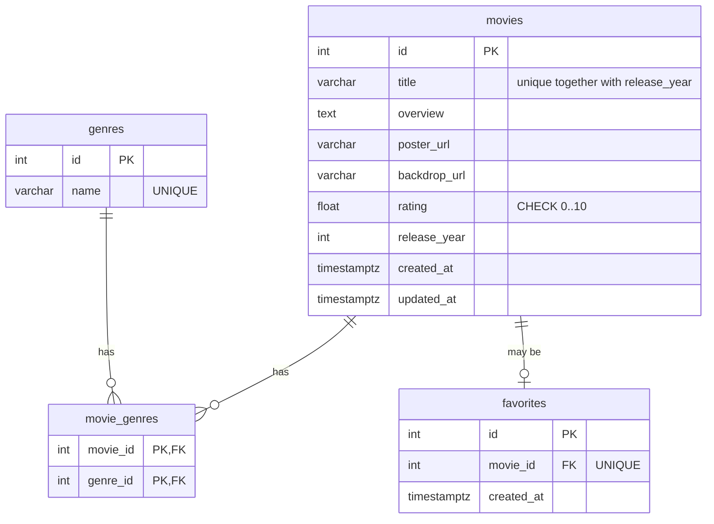

# Movie Explorer API

A REST API backend for the **Movie Explorer** Android app, built with **FastAPI + SQLAlchemy 2.0 + PostgreSQL**.

It replaces the app's `FakeMovieApiService` (hard-coded movies) and its local Room favorites table with a real backend:

- browse movies (paginated, best rated first)
- search movies by title or genre
- get movie details
- add / remove / list favorites
- **create, update, and delete movies** (new: the app had no write operations)

This is a **learning project**. Every file has comments explaining *what* the code does and *why*. This README walks you through it step by step. Read it from top to bottom the first time.

---

## Table of contents

1. [Tech stack: what each library does](#1-tech-stack-what-each-library-does)
2. [Android to backend: a mental map](#2-android-to-backend-a-mental-map)
3. [Project structure](#3-project-structure)
4. [The life of a request (follow the code)](#4-the-life-of-a-request-follow-the-code)
5. [Database design](#5-database-design)
6. [Setup from scratch](#6-setup-from-scratch)
7. [Daily commands (cheat sheet)](#7-daily-commands-cheat-sheet)
8. [API reference](#8-api-reference)
9. [Database migrations with Alembic](#9-database-migrations-with-alembic)
10. [Automated tests](#10-automated-tests)
11. [Exploring the data in pgAdmin](#11-exploring-the-data-in-pgadmin)
12. [Python concepts used in this project](#12-python-concepts-used-in-this-project)
13. [Design decisions explained](#13-design-decisions-explained)
14. [Connecting the Android app (next phase)](#14-connecting-the-android-app-next-phase)
15. [Suggested reading order and exercises](#15-suggested-reading-order-and-exercises)

---

## 1. Tech stack: what each library does

| Library | Role | Android equivalent |
|---|---|---|
| **FastAPI** | Web framework: defines endpoints, parses requests, validates input, generates docs | Retrofit interface, but on the *server* side |
| **Uvicorn** | The server program that actually listens on port 8000 and runs FastAPI | (the OS / Android runtime) |
| **Pydantic** | Validates data and converts it to and from JSON (request/response bodies) | Gson / Moshi / kotlinx.serialization, with validation built in |
| **pydantic-settings** | Loads config from `.env` / environment variables | `BuildConfig`, `local.properties` |
| **SQLAlchemy 2.0** | ORM: Python classes become tables, Python objects become rows | Room (`@Entity`, `@Dao`) |
| **psycopg 3** | Low-level PostgreSQL driver that SQLAlchemy uses to talk to the DB | The SQLite driver under Room |
| **Alembic** | Database migrations (versioned schema changes) | Room `Migration(1, 2)` |
| **pytest** | Test runner | JUnit |
| **httpx / TestClient** | Calls the API in tests without starting a real server | MockWebServer / Compose test rule |

Python version: **3.15** (the one installed on this machine).

---

## 2. Android to backend: a mental map

You already know layered architecture from Android. The backend uses the **same idea**:

```
 ANDROID APP (Movie Explorer)                 BACKEND (this project)
 ────────────────────────────                 ──────────────────────
 Composable Screen                            HTTP client (Android app / Postman)
        │                                              │  HTTP request (JSON)
 ViewModel                     ◄──────────►   Route / endpoint        app/api/routes/
        │                                              │
 UseCase                       ◄──────────►   Service                 app/services/
        │                                              │
 Repository / DAO              ◄──────────►   Repository              app/repositories/
        │                                              │
 Room @Entity                  ◄──────────►   SQLAlchemy Model        app/models/
 DTO (MovieDto)                ◄──────────►   Pydantic Schema         app/schemas/
 Hilt @Module                  ◄──────────►   FastAPI Depends()       app/api/deps.py
 SQLite file                   ◄──────────►   PostgreSQL server
```

**The rule:** each layer only talks to the layer directly below it.

- **Routes** know HTTP (status codes, query params). They don't know SQL.
- **Services** know business rules ("no duplicates", "favorite must point to an existing movie"). They don't know HTTP.
- **Repositories** know SQL queries. They don't know business rules.
- **Models** describe tables. **Schemas** describe JSON.

---

## 3. Project structure

```
movie-explorer-api/
├── app/                          ← all application code
│   ├── main.py                   ← creates the FastAPI app (START HERE)
│   ├── core/                     ← app-wide infrastructure
│   │   ├── config.py             ← settings loaded from .env
│   │   ├── database.py           ← engine, sessions, get_db() dependency
│   │   └── exceptions.py         ← NotFoundError / ConflictError + JSON handlers
│   ├── models/                   ← DATABASE TABLES (SQLAlchemy)
│   │   ├── base.py               ← Base class, naming conventions, timestamps mixin
│   │   ├── movie.py              ← movies table + movie_genres link table
│   │   ├── genre.py              ← genres table
│   │   └── favorite.py           ← favorites table
│   ├── schemas/                  ← JSON SHAPES (Pydantic)
│   │   ├── common.py             ← CamelModel: snake_case in Python, camelCase in JSON
│   │   ├── movie.py              ← MovieCreate, MovieUpdate, MovieResponse, MovieListResponse
│   │   └── health.py
│   ├── repositories/             ← SQL QUERIES
│   │   ├── movie_repository.py
│   │   ├── genre_repository.py
│   │   └── favorite_repository.py
│   ├── services/                 ← BUSINESS LOGIC
│   │   ├── movie_service.py
│   │   └── favorite_service.py
│   └── api/                      ← HTTP LAYER
│       ├── deps.py               ← dependency injection (session → service)
│       ├── router.py             ← groups all /api/v1 routers
│       └── routes/
│           ├── health.py         ← GET /health
│           ├── movies.py         ← /api/v1/movies endpoints
│           └── favorites.py      ← /api/v1/favorites endpoints
├── alembic/                      ← database migrations
│   ├── env.py                    ← connects Alembic to our settings + models
│   └── versions/                 ← one file per schema change
├── alembic.ini                   ← Alembic config
├── scripts/
│   └── seed_movies.py            ← fills the DB with 16 sample movies
├── tests/                        ← automated tests (pytest)
│   ├── conftest.py               ← shared fixtures (test DB, test client)
│   ├── test_movies.py
│   └── test_favorites.py
├── requirements.txt              ← pinned dependencies
├── .env                          ← YOUR local secrets (git-ignored)
└── .env.example                  ← template for .env (safe to commit)
```

> **What are the `__init__.py` files?** They mark a folder as a Python *package* so you can write `from app.models import Movie`. Some of them also re-export names to make imports shorter.

---

## 4. The life of a request (follow the code)

Let's trace `GET /api/v1/movies/1` through the files. Open each file as you read.

1. **`app/main.py`**: the request arrives. `app.include_router(api_router, prefix="/api/v1")` sends anything starting with `/api/v1` to `api_router`.
2. **`app/api/router.py`**: `api_router` includes `movies.router`, which has `prefix="/movies"`.
3. **`app/api/routes/movies.py`**: `@router.get("/{movie_id}")` matches. FastAPI sees `movie_id: int` and converts `"1"` to `1`. If you send `/movies/abc`, it answers **422** automatically.
4. Before calling the function, FastAPI resolves `service: MovieServiceDep`. In **`app/api/deps.py`** that means: call `get_db()` to get a Session, then `get_movie_service(db)` to get a `MovieService(db)`.
5. **`app/core/database.py`**: `get_db()` opens a Session and `yield`s it. (It will be closed after the response is sent.)
6. **`app/services/movie_service.py`**: `get_movie(1)` asks the repository. If the result is `None` it raises `NotFoundError`.
7. **`app/repositories/movie_repository.py`**: `self.db.get(Movie, 1)` runs `SELECT ... FROM movies WHERE id = 1`. Because `genres` and `favorite` use `lazy="selectin"`, SQLAlchemy also loads them.
8. Back in the route: the function returns a `Movie` **database object**. Because of `response_model=MovieResponse`, FastAPI converts it with Pydantic: it reads `movie.title`, `movie.poster_url`, `movie.is_favorite`, and so on, turns `genres` objects into names, and renames keys to camelCase.
9. The JSON is sent back, and `get_db()` runs its `finally:` block and closes the session.

**If the movie doesn't exist:** step 6 raises `NotFoundError`, and the handler in **`app/core/exceptions.py`** turns it into `404 {"detail": "Movie with id 1 was not found."}`.

> **Tip:** with `DEBUG=true` in `.env`, every SQL query is printed in the terminal. Call an endpoint and watch the SQL. It's the fastest way to learn what the ORM does.

---

## 5. Database design



| Table | Purpose |
|---|---|
| `movies` | One row per movie |
| `genres` | One row per genre name ("Drama", "Sci-Fi", ...), stored once |
| `movie_genres` | **Many-to-many** link: a movie has many genres, a genre has many movies |
| `favorites` | One row per favorited movie (no users yet, so it's one global list) |
| `alembic_version` | Created by Alembic. Stores which migration was applied last. Don't edit it. |

**Constraints (rules PostgreSQL enforces, even if someone bypasses the API):**

- `uq_movies_title_release_year`: no two movies with the same title *and* year
- `ck_movies_rating_range`: rating must be between 0 and 10
- `uq_genres_name`: no duplicate genre names
- `uq_favorites_movie_id`: a movie can be favorited only once
- Foreign keys with `ON DELETE CASCADE`: deleting a movie also deletes its genre links and its favorite

---

## 6. Setup from scratch

> On this machine, **everything below is already done**. These steps are for a new machine, or if you want to redo it yourself to learn.

### 6.1 Prerequisites

- Python 3.12+ (`python3 --version`)
- PostgreSQL running (Postgres.app) and `psql` available

### 6.2 Create the database user and databases

```bash
psql -h localhost -d postgres
```

Then, inside `psql`:

```sql
CREATE ROLE movie_api_user WITH LOGIN PASSWORD 'choose-a-password';
CREATE DATABASE movie_explorer_db OWNER movie_api_user;       -- used by the API
CREATE DATABASE movie_explorer_test_db OWNER movie_api_user;  -- used by the tests
\q
```

> **Why a dedicated user?** The app should never connect as the superuser. If it were compromised, the damage would be limited to its own databases.

### 6.3 Virtual environment and dependencies

A **virtual environment** (`.venv/`) is a private folder of packages just for this project, similar to how each Gradle project has its own dependencies.

```bash
cd movie-explorer-api
python3 -m venv .venv
source .venv/bin/activate
pip install -r requirements.txt
```

`source .venv/bin/activate` must be run **in every new terminal**. Your prompt shows `(.venv)` when it's active.

### 6.4 Configure `.env`

```bash
cp .env.example .env
```

Edit `.env` and put your real password into `DATABASE_URL` and `TEST_DATABASE_URL`.

### 6.5 Create tables, seed data, run

```bash
alembic upgrade head
```

```bash
python -m scripts.seed_movies
```

```bash
fastapi dev app/main.py
```

Open **http://127.0.0.1:8000/docs**. 🎉

---

## 7. Daily commands (cheat sheet)

Always activate the virtual environment first:

```bash
source .venv/bin/activate
```

| Task | Command |
|---|---|
| Run the API with auto-reload (development) | `fastapi dev app/main.py` |
| Run so a phone or emulator on your network can reach it | `fastapi dev app/main.py --host 0.0.0.0` |
| Run the tests | `pytest` (or `pytest -v` for names) |
| Apply all migrations | `alembic upgrade head` |
| Create a migration after editing models | `alembic revision --autogenerate -m "describe change"` |
| Undo the last migration | `alembic downgrade -1` |
| Show the migration history | `alembic history` |
| Check models and DB are in sync | `alembic check` |
| Seed sample movies (safe to re-run) | `python -m scripts.seed_movies` |
| Install a new package | `pip install <name>`, then add it to `requirements.txt` |

---

## 8. API reference

Interactive docs: **http://127.0.0.1:8000/docs** (Swagger UI: click an endpoint, then **Try it out**, then **Execute**).
Raw OpenAPI spec: **http://127.0.0.1:8000/openapi.json**

> **Postman:** in Postman choose **Import**, then **Link**, and paste `http://127.0.0.1:8000/openapi.json`. It creates a collection with every endpoint for you.

### Endpoints

| Method | Path | Description | Success | Errors |
|---|---|---|---|---|
| GET | `/health` | API and database status | 200 | |
| GET | `/api/v1/movies` | List / search movies (paginated) | 200 | 422 |
| GET | `/api/v1/movies/{id}` | Movie details | 200 | 404 |
| POST | `/api/v1/movies` | Create a movie | **201** | 409, 422 |
| PATCH | `/api/v1/movies/{id}` | Update some fields of a movie | 200 | 404, 409, 422 |
| DELETE | `/api/v1/movies/{id}` | Delete a movie | **204** | 404 |
| GET | `/api/v1/favorites` | List favorite movies (newest first) | 200 | 422 |
| PUT | `/api/v1/favorites/{movie_id}` | Add to favorites (idempotent) | 200 | 404 |
| DELETE | `/api/v1/favorites/{movie_id}` | Remove from favorites (idempotent) | **204** | 404 |

**Query parameters** for the list endpoints:

| Param | Default | Rules | Meaning |
|---|---|---|---|
| `search` | (none) | max 100 chars | Case-insensitive match on title **or** genre (`/movies` only) |
| `limit` | 20 | 1–100 | Page size |
| `offset` | 0 | ≥ 0 | Items to skip (page 2 with limit 20 is `offset=20`) |

### Status codes used

| Code | Meaning | When |
|---|---|---|
| 200 OK | Success with a body | GET, PATCH, PUT |
| 201 Created | A new resource was created | POST /movies |
| 204 No Content | Success, empty body | DELETE |
| 404 Not Found | The id doesn't exist | wrong movie id |
| 409 Conflict | Clashes with existing data | duplicate title + year |
| 422 Unprocessable Entity | Validation failed | rating 11, empty title, `limit=500`, ... |

### Examples (curl)

List the first 3 movies:

```bash
curl "http://127.0.0.1:8000/api/v1/movies?limit=3"
```

```json
{
  "items": [
    {
      "id": 12,
      "title": "The Quiet Archive",
      "overview": "A librarian discovers a room of books describing events that have not happened yet.",
      "posterUrl": "https://picsum.photos/seed/quiet-archive/500/750",
      "backdropUrl": "https://picsum.photos/seed/archive-backdrop/1200/675",
      "rating": 8.6,
      "releaseYear": 2023,
      "genres": ["Fantasy", "Mystery"],
      "isFavorite": false,
      "createdAt": "2026-11-10T09:25:48.073194+05:00",
      "updatedAt": "2026-11-10T09:25:48.073194+05:00"
    }
  ],
  "total": 16,
  "limit": 3,
  "offset": 0
}
```

Search (title or genre):

```bash
curl "http://127.0.0.1:8000/api/v1/movies?search=mystery"
```

Create a movie:

```bash
curl -X POST "http://127.0.0.1:8000/api/v1/movies" \
  -H "Content-Type: application/json" \
  -d '{
    "title": "Lantern Sea",
    "overview": "A lighthouse keeper follows floating lanterns to a hidden island.",
    "posterUrl": "https://picsum.photos/seed/lantern-sea/500/750",
    "backdropUrl": "https://picsum.photos/seed/lantern-sea-bg/1200/675",
    "rating": 7.2,
    "releaseYear": 2026,
    "genres": ["Adventure", "Fantasy"]
  }'
```

Update only the rating:

```bash
curl -X PATCH "http://127.0.0.1:8000/api/v1/movies/1" \
  -H "Content-Type: application/json" -d '{"rating": 8.9}'
```

Add movie 7 to favorites, list favorites, then remove it:

```bash
curl -X PUT "http://127.0.0.1:8000/api/v1/favorites/7"
```

```bash
curl "http://127.0.0.1:8000/api/v1/favorites"
```

```bash
curl -X DELETE "http://127.0.0.1:8000/api/v1/favorites/7"
```

Error format (always the same shape):

```json
{ "detail": "Movie with id 999 was not found." }
```

Validation errors (422) list each invalid field:

```json
{ "detail": [ { "loc": ["body", "rating"], "msg": "Input should be less than or equal to 10", "type": "less_than_equal" } ] }
```

---

## 9. Database migrations with Alembic

**Problem:** your models change over time (new column, new table). The database must change too, on your machine, on teammates' machines, and on the production server, in the same order and without losing data.

**Solution:** Alembic stores each change as a numbered Python file in `alembic/versions/`, like commits in Git.

### The workflow every time you change a model

1. Edit a model, for example add `runtime_minutes: Mapped[int | None]` to `Movie` in `app/models/movie.py`.
2. Generate a migration:
   ```bash
   alembic revision --autogenerate -m "add runtime to movies"
   ```
3. **Open and read the generated file** in `alembic/versions/`. Check that `upgrade()` and `downgrade()` look right.
4. Apply it:
   ```bash
   alembic upgrade head
   ```
5. Update the schemas (`app/schemas/movie.py`) if the field should appear in the API.

The first migration in this project is `alembic/versions/2026_11_10_0925-..._create_movies_genres_favorites_tables.py`. Read it to see what the generated SQL operations look like.

> ⚠️ **Never edit a migration that was already applied and shared.** Create a new one instead, just like you wouldn't rewrite a pushed Git commit.

---

## 10. Automated tests

```bash
pytest -v
```

21 tests cover: create (201), validation (422, including genre names longer than the 50-character column), duplicates (409), not found (404), pagination, sorting, search by title and genre, partial update, delete, and every favorites rule including "deleting a movie removes its favorite".

How it works (see `tests/conftest.py`):

- Tests use **`movie_explorer_test_db`**, never your real data.
- Tables are created once from the models; after **each** test all tables are emptied (`TRUNCATE`).
- `app.dependency_overrides[get_db] = override_get_db` swaps the real database session for the test one. This is FastAPI's version of injecting a fake in Hilt tests.
- `TestClient` calls the app in memory, so no server needs to be running.

> **Real story from building this project:** the test `test_deleting_movie_also_removes_its_favorite` failed the first time. SQLAlchemy was trying to set `favorites.movie_id = NULL` instead of deleting the row. The fix (`cascade="all, delete-orphan"` in `app/models/movie.py`) is explained in a comment there. That's exactly why tests are worth writing.

---

## 11. Exploring the data in pgAdmin

In pgAdmin, register a server: host `localhost`, port `5432`, user `movie_api_user`, and the password from `.env`. Open **movie_explorer_db**, go to **Query Tool**, and try:

```sql
-- All movies, best first
SELECT id, title, rating, release_year FROM movies ORDER BY rating DESC;

-- Movies with their genres as one text column (this is what the many-to-many looks like in SQL)
SELECT m.title, string_agg(g.name, ', ' ORDER BY g.name) AS genres
FROM movies m
JOIN movie_genres mg ON mg.movie_id = m.id
JOIN genres g        ON g.id = mg.genre_id
GROUP BY m.id, m.title
ORDER BY m.title;

-- How many movies per genre
SELECT g.name, COUNT(*) AS movie_count
FROM genres g JOIN movie_genres mg ON mg.genre_id = g.id
GROUP BY g.name ORDER BY movie_count DESC;

-- Favorites with titles
SELECT f.created_at, m.title
FROM favorites f JOIN movies m ON m.id = f.movie_id
ORDER BY f.created_at DESC;

-- Which migration is the database on?
SELECT * FROM alembic_version;
```

Try an invalid insert to see a constraint in action:

```sql
UPDATE movies SET rating = 11 WHERE id = 1;  -- fails: violates ck_movies_rating_range
```

---

## 12. Python concepts used in this project

A quick reference for syntax you'll see, with Kotlin comparisons.

| Python | Meaning | Kotlin-ish equivalent |
|---|---|---|
| `def get_movie(self, movie_id: int) -> Movie:` | Function with type hints | `fun getMovie(movieId: Int): Movie` |
| `Movie \| None` | Nullable type | `Movie?` |
| `list[str]` | List of strings | `List<String>` |
| `class MovieService:` + `def __init__(self, db):` | Class + constructor. `self` = `this` | `class MovieService(val db: Session)` |
| `self.db = db` | Store a property | `private val db = db` |
| `_get_or_create_genres` (leading `_`) | "Private by convention" | `private fun` |
| `@property` | Computed property | `val isFavorite get() = ...` |
| `@classmethod` | Method on the class, not an instance | `companion object` function |
| `@router.get("/...")` | **Decorator**: wraps / registers a function | Annotation like `@GET` in Retrofit |
| `f"Movie {movie_id}"` | String interpolation | `"Movie $movieId"` |
| `yield` inside a function | Generator: pause, hand out a value, resume later | (similar to `use { }` or `try/finally`) |
| `with SessionLocal() as db:` | **Context manager**: auto-cleanup at the end | `.use { db -> }` |
| `try: ... except ConflictError:` | Catch an exception | `try { } catch (e: ConflictError) { }` |
| `raise NotFoundError("...")` | Throw an exception | `throw NotFoundError("...")` |
| `Annotated[int, Query(ge=1)]` | Type + extra metadata for FastAPI | Annotated parameter |
| `**movie_data` | Unpack a dict into keyword args | `MovieCreate(title = ..., rating = ...)` |
| `if __name__ == "__main__":` | Only run when executed directly | `fun main()` |
| `from app.models import Movie` | Import | `import co.bitfuse....Movie` |

**Sync vs async:** endpoints here are normal `def` functions (not `async def`). FastAPI runs them in a thread pool, so they don't block each other. Synchronous SQLAlchemy is simpler to learn; async is a later step (see exercises).

**Connection pool sizing (bug found by a load test):** FastAPI uses **40** worker threads, but SQLAlchemy's default pool has only **15** connections (5 + 10 overflow). With 200 requests at once, threads waited for connections while the cleanup that would free one also needed a thread, so the app froze: only 24 of 200 requests succeeded. The pool is now 20 + 20 = 40 (`DB_POOL_SIZE`, `DB_MAX_OVERFLOW` in `.env`), and all 200 succeed in under a second. Rule: `pool_size + max_overflow` ≥ worker threads. Details are in the comments in `app/core/database.py`.

---

## 13. Design decisions explained

**Why camelCase JSON?**
Your Android `MovieDto` already uses `posterUrl`, `releaseYear`, ... . `CamelModel` (in `app/schemas/common.py`) lets Python keep `snake_case` while the JSON uses `camelCase`, so the app needs almost no changes.

**Why `releaseYear` is a number, not a string?**
The Android DTO stores it as `String`, but a year is a number: it can be validated (1888–2100) and sorted. The Android DTO will change `releaseYear` to `Int` in the next phase.

**Why search is a query parameter, not a separate endpoint?**
In REST, searching is just *filtering a collection*: `GET /movies?search=star`. One endpoint handles "trending" (no search) and "search" (with search), with the same pagination.

**Why the list response is an object (`items`, `total`, ...) and not a plain array?**
So pagination info travels with the data, and new fields can be added later without breaking clients. (A top-level array cannot grow new fields.)

**Why PUT / DELETE for favorites instead of a toggle?**
They're *idempotent*: sending the same request twice gives the same result. A toggle sent twice by a retrying mobile client would undo itself.

**Why a separate `favorites` table instead of `is_favorite` on movies?**
Favorites belong to a *user*. When authentication arrives, we add `user_id` to `favorites`, and `movies` stays untouched.

**Why services raise `NotFoundError` instead of FastAPI's `HTTPException`?**
Services shouldn't know they're behind HTTP. The seed script uses `MovieService` with no HTTP at all.

**Why repositories don't commit?**
One business operation = one transaction. Creating a movie inserts into `movies`, maybe `genres`, and `movie_genres`. Either all of it is saved or none of it is. The service calls `commit()` once at the end.

---

## 14. Connecting the Android app (next phase)

The API mirrors the Android `MovieApiService` interface:

| Android (`MovieApiService` / Room) | Backend endpoint |
|---|---|
| `getTrendingMovies()` | `GET /api/v1/movies` |
| `searchMovies(query)` | `GET /api/v1/movies?search={query}` |
| `getMovieDetails(id)` | `GET /api/v1/movies/{id}` |
| `observeFavoriteMovies()` (Room) | `GET /api/v1/favorites` |
| `toggleFavorite(movie)`: add | `PUT /api/v1/favorites/{id}` |
| `toggleFavorite(movie)`: remove | `DELETE /api/v1/favorites/{id}` |
| Add Movie screen | `POST /api/v1/movies` |

Notes for that phase:

- **Emulator base URL:** `http://10.0.2.2:8000/api/v1/` (`10.0.2.2` is the emulator's alias for your Mac's `localhost`).
- **Physical phone:** run `fastapi dev app/main.py --host 0.0.0.0` and use your Mac's Wi-Fi IP.
- **Cleartext HTTP:** Android blocks plain `http://` by default. A debug-only `network_security_config.xml` allowing `10.0.2.2` is needed.
- **DTO changes:** `releaseYear: Int`, add `isFavorite: Boolean`, and wrap lists in a response class with `items`, `total`, `limit`, `offset`.
- The 16 seeded movies include the app's original 8 with the **same ids (1–8)** and data.

---

## 15. Suggested reading order and exercises

### Read the code in this order

1. `app/main.py`
2. `app/core/config.py`, then `app/core/database.py`
3. `app/models/base.py`, `movie.py`, `genre.py`, `favorite.py`
4. `alembic/versions/*.py` (the SQL operations the models produced)
5. `app/schemas/common.py`, then `app/schemas/movie.py`
6. `app/repositories/movie_repository.py`
7. `app/services/movie_service.py`
8. `app/api/deps.py`, then `app/api/routes/movies.py`
9. `app/core/exceptions.py`
10. The favorites files (same pattern, so you'll recognize everything)
11. `tests/conftest.py`, then the tests

### Exercises (roughly easiest to hardest)

1. **Add a `GET /api/v1/genres` endpoint** that lists all genre names. You'll touch: repository → service → schema → route → `router.py`. Write a test.
2. **Add a `genre` filter:** `GET /movies?genre=Drama` (exact genre, combined with `search`).
3. **Add a `runtime_minutes` column** to `Movie` (optional / nullable). Practice the full Alembic workflow from section 9.
4. **Add sorting:** `GET /movies?sort=rating|year|title`.
5. **Add CORS** (`fastapi.middleware.cors.CORSMiddleware`) so a web frontend could call the API.
6. **Dockerize:** a `Dockerfile` for the API + `docker-compose.yml` with PostgreSQL.
7. **Authentication (JWT):** a `users` table, sign up / log in, and `user_id` on `favorites`.
8. **Async version:** switch to `create_async_engine`, `AsyncSession`, and `async def` endpoints, then compare.

After these, you'll be well prepared for the AI-engineering path: an LLM or RAG feature is "just" another service behind an endpoint like these.
